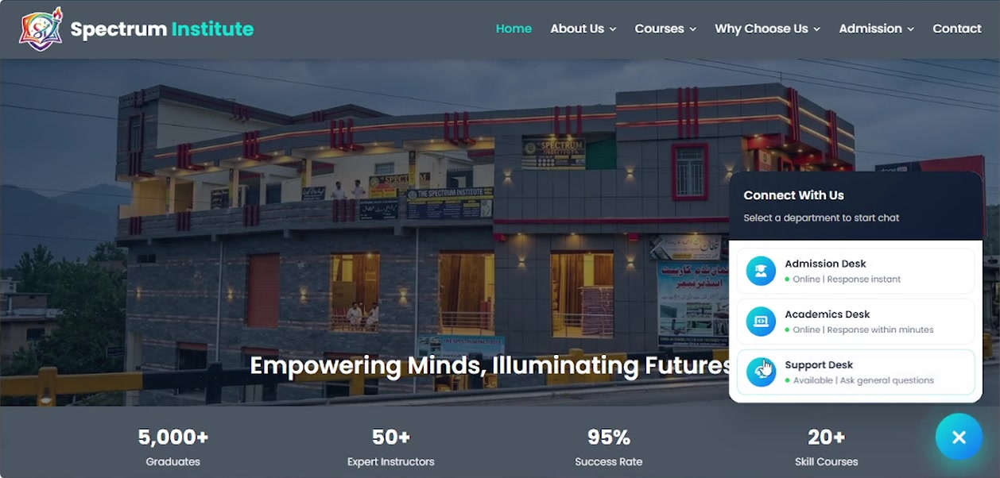
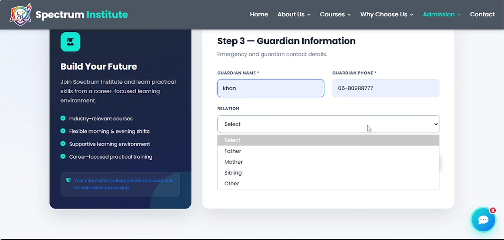
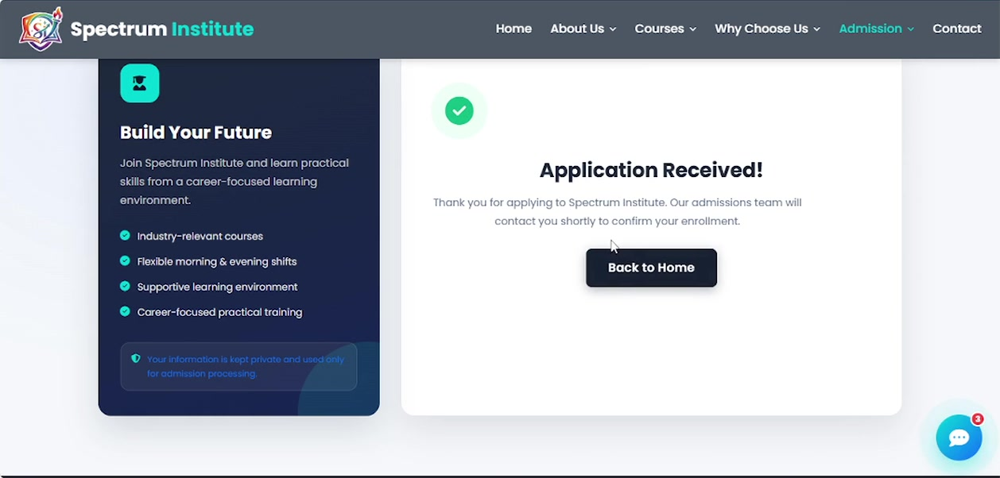

# Spectrum Institute Website

A multi-page website for a computer training institute, with an online admission form that saves every application to a database.

Built with plain HTML, CSS and JavaScript, plus a Supabase (PostgreSQL) backend. No frameworks.



| Admission form | Application saved |
|---|---|
|  |  |

## Features

- **6 pages:** Home, About, Courses, Why Us, Admission, Contact.
- **8 course listings:** Cyber Security, AI Engineering, ICT, Basic Computer Skills, Web & Software Development, Graphics Designing, DIT (Diploma in IT), Digital Marketing.
- **4-step admission form:** Personal Info, Contact Info, Guardian Info, Course & Shift. Each step is checked before the student can move on.
- **Database storage:** each completed application is inserted into an `admissions` table in Supabase. If the database is not reachable, the form shows an error and does not pretend the application was saved.
- **Safe database rules:** Row Level Security is on. The public website can only add rows. It cannot read, edit or delete them.
- **Contact form:** messages from the Contact page are saved to a `contact_messages` table. If sending fails, the visitor sees an error instead of a false success message.
- **Help chat widget:** visitors pick a department and get quick answers, with a WhatsApp button to reach staff.
- **Interface details:** typing animation on the home page, animated statistics counters, image slideshow, mobile navigation menu, and responsive layout.

## Tech stack

| Part | Tool |
|---|---|
| Pages and layout | HTML5, CSS3 |
| Behavior | Vanilla JavaScript |
| Database | Supabase (PostgreSQL) |
| Local testing | VS Code Live Server |

## Project structure

```
index.html, about.html, programs.html,
why-us.html, admission.html, contact.html
style.css            all styling
script.js            navigation, form steps, chat widget, animations
supabase-config.js   database connection and save function
images/              slideshow, course and logo images
logo-assets/         logo files in different formats
screenshots/         images used in this README
```

## Run it locally

1. Download or clone this repository.
2. Open the folder in VS Code and start **Live Server** on `index.html`.
3. To store admissions, create a free project at supabase.com and run this in the SQL Editor:

```sql
create table admissions (
  id bigint generated always as identity primary key,
  full_name text, father_name text, dob date, gender text,
  email text, phone text, address text,
  guardian_name text, guardian_phone text, guardian_relation text,
  course text, shift text,
  submitted_at timestamptz default now()
);
alter table admissions enable row level security;
create policy "Allow public inserts" on admissions
  for insert to anon with check (true);
```

4. Also create the table for contact messages (the SQL is in a comment inside `supabase-config.js`):

```sql
create table contact_messages (
  id bigint generated always as identity primary key,
  full_name text, email text, course text, message text,
  submitted_at timestamptz default now()
);
alter table contact_messages enable row level security;
create policy "Allow public inserts" on contact_messages
  for insert to anon with check (true);
```

5. Open `supabase-config.js` and set `SUPABASE_URL` and `SUPABASE_ANON_KEY` to the values from Project Settings, then API. Only use the public (anon/publishable) key here, never the secret key.

## Author

**Muhammad Hashmi** · Swat, Pakistan · hashmi.freelance@gmail.com
